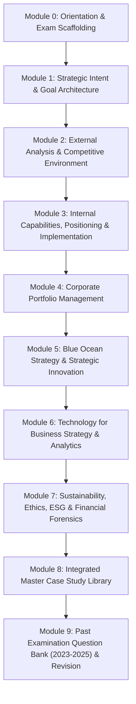
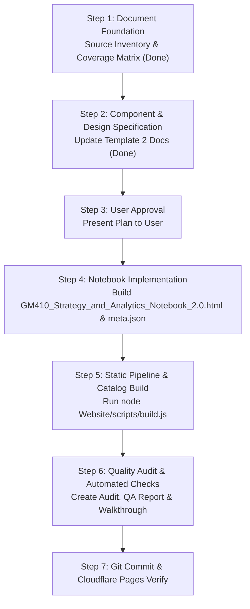

# GM 410: Integrative Manager for Analytics — Master Implementation Plan (Notebook 2.0)

> **Document Status**: Production Architectural Blueprint & Master Execution Plan  
> **Course**: GM 410 — Integrative Manager for Analytics (PGDM Research & Business Analytics, Welingkar Institute / WeSchool)  
> **Faculty**: Dr. Sonal Daulatkar (Strategic Management & Case Lead), Dr. Sangeetha Rajesh (Technology for Business Strategy)  
> **Repository Target**: `D:\Brain\05_Knowledge`  
> **Target Artifacts**:  
> - `Management/GM410_Strategy_and_Analytics_Notebook_2.0.html`  
> - `Management/GM410_Strategy_and_Analytics_Notebook_2.0.meta.json`

---

## 1. Goal Description & Strategic Objective

The objective is to implement a comprehensive, academically rigorous, publication-grade, interactive **Notebook 2.0 for GM 410: Integrative Manager for Analytics** in the `Brain Knowledge Hub` (`D:\Brain\05_Knowledge`). 

This notebook serves as the definitive master resource for PGDM Research & Business Analytics students at Welingkar Institute (WeSchool). It teaches strategy and analytics from first principles, connects seminal theoretical frameworks to empirical business decisions, provides complete case dossiers for all examined firms (including all 15 INSEAD teaching note poll questions for NVIDIA), and supplies authentic model answers with marking rubrics for all 2023–2025 past examination papers.

---

## 2. User Review Required

> [!IMPORTANT]
> **Key Decisions & Architectural Choices for User Confirmation:**
> 1. **Primary Workspace File Placement**: The notebook will be generated at `D:\Brain\05_Knowledge\Management\GM410_Strategy_and_Analytics_Notebook_2.0.html` with companion `Management\GM410_Strategy_and_Analytics_Notebook_2.0.meta.json`. It will be categorized under `Management` (with cross-links in `Analytics`), ensuring the static generator `Website/scripts/build.js` automatically compiles and publishes it to `Website/dist/notebooks/gm410-strategy-and-analytics-notebook-2.0.html`.
> 2. **Refined Academic Library Aesthetic**: The visual design strictly implements the requested warm off-white and cream paper surfaces (`#fcf8ee`), restrained navy (`#1d3c8c`), forest green (`#1d7a45`), and burgundy (`#8b1e2f`) accents, serif typography (`STIX Two Text` / `Newsreader`), sans-serif UI (`Source Sans 3`), and selective handwritten annotations (`Caveat`, `Patrick Hand`).
> 3. **Single-Line Ruled Paper Treatment**: Implemented as a mathematically aligned single-line rule beneath text lines (`line-height: 32px`), strictly bounded to the active text flow, protecting font descenders, with all knowledge components (cards, tables, diagrams, formulas) styled with solid opaque backgrounds to prevent lines cutting across diagrams or text. A toggle (`data-ruling="off"`) ensures 100% functionality with decorative ruling disabled.
> 4. **100% Examination & Case Reconciled Coverage**: All questions from 2025 (Microsoft case + 7 optionals), 2024 (Amazon case + 7 optionals), and 2023 (Coca-Cola 5-question case) are provided with authentic model answers, marking checklists, and common pitfalls. All 15 NVIDIA INSEAD poll questions are analyzed with correct options, pedagogy, distractor critique, and exam adaptations.

> [!NOTE]
> No destructive changes will be made to existing files. Existing files (`ERP_Exam_Notebook.html`, `Operations/ERP_Business_Applications_Notebook_2.0.html`) are preserved as benchmarks.

---

## 3. Open Questions

> [!TIP]
> All core pedagogical and source questions have been resolved from local source analysis:
> - Faculty identity and institutional context: Dr. Sonal Daulatkar & Dr. Sangeetha Rajesh, Welingkar Institute (WeSchool), PGDM Research & Business Analytics.
> - "Phrase Model" resolution: Reconciled as the seminal Dunphy, Griffiths & Benn (2003/2007) corporate sustainability Phase Model (3 waves, 6 steps), which was misprinted as "Phrase model" in the 2023 paper.
> - Source coverage: All 12 source files across downloads and course folders have been mapped in `GM410_SOURCE_INVENTORY.md` and `GM410_COVERAGE_MATRIX.md`.

---

## 4. Visual Architecture & Design Engine

### 4.1 Visual Identity Specification
- **Paper Canvas**: Warm cream tone (`#fcf8ee` light, `#18202e` dark mode), subtle grain texture, red margin line at 58px (`#e28b8b`), and authentic notebook binding punches.
- **Accents**: Oxford Navy (`#1d3c8c`), Scholarly Forest Green (`#1d7a45`), Academic Burgundy (`#8b1e2f`), Amber highlight (`rgba(255, 224, 61, 0.65)`).
- **Typography**: 
  - Editorial Headings & Math: `STIX Two Text` / `Georgia`
  - Sans Body & Controls: `Source Sans 3` / `system-ui`
  - Handwritten Accents: `Caveat` / `Patrick Hand`
  - Technical / Code: `JetBrains Mono` / `monospace`

### 4.2 Mandatory Single-Line Ruling Implementation
```css
/* Mathematically locked single-line baseline grid */
:root {
  --line-height: 32px;
  --rule: #dce6f0;
}
[data-theme="dark"] {
  --rule: #232f46;
}

.sheet {
  position: relative;
  background-color: var(--paper);
  background-image: 
    var(--grain), 
    repeating-linear-gradient(
      to bottom,
      transparent 0px,
      transparent calc(var(--line-height) - 1px),
      var(--rule) calc(var(--line-height) - 1px),
      var(--rule) var(--line-height)
    );
  background-size: 100% var(--line-height);
  background-position: 0 16px;
  line-height: var(--line-height);
  padding: 36px 42px 40px 78px;
  border: 1px solid var(--line);
  border-radius: 8px 14px 14px 8px;
  box-shadow: var(--shadow-sheet);
  overflow: hidden; /* Ends cleanly at content boundary */
}

/* Red Margin Rule & Hole Punches */
.sheet::before {
  content: "";
  position: absolute;
  left: 56px;
  top: 0;
  bottom: 0;
  width: 2px;
  background: var(--margin);
  opacity: 0.75;
}

/* Two-layer shield: all components are completely opaque */
.nb-card, .nb-case-card, .nb-diagram-card, .tblwrap, 
.nb-fbox, .nb-exam-card, .nb-quiz-card, .nb-sticky {
  background: var(--paper2) !important;
  line-height: 1.6;
  border: 1.5px solid var(--line);
  border-radius: 8px;
  position: relative;
  z-index: 2;
  box-shadow: var(--shadow-card);
}

/* Zero-ruling accessible fallback */
[data-ruling="off"] .sheet {
  background-image: var(--grain);
}
```

---

## 5. Proposed Module Architecture & Content Hierarchy



### Module Breakdown
- **Module 0: Course Orientation & Examination Strategy**
  - Syllabi, course outcomes, grading architecture.
  - The 5-stage MBA answer scaffold: Definition → Framework → Case Evidence → Evaluation → Decision.
  - Question-to-concept index & revision timeline.
- **Module 1: Strategic Intent & Goal Architecture**
  - Vision, Mission, Values, Aims, Goals, Objectives, Strategy.
  - SMART objectives criteria with industrial examples.
  - Graham Kenny (HBR 2023) Stakeholder Goal Setting (Behavioral outcomes → Org objectives → KPIs).
  - Mintzberg’s 5 Ps of Strategy & Deliberate vs Emergent strategy.
  - Michael Porter (HBR 1996): Operational Effectiveness vs Strategic Positioning, Trade-offs, and Activity Fit.
- **Module 2: External Analysis & Competitive Environment**
  - Porter's Five Forces Model (in-depth structural economics).
  - PESTEL analysis framework.
  - Worked applications: Wearable fitness device tariff shock mitigation (2025 PYQ 1f) and electric two-wheeler market opportunity scan (2024 PYQ 1g).
  - External threats/opportunities linkage to internal strengths/weaknesses.
- **Module 3: Internal Capabilities, Strategic Positioning & Implementation**
  - Porter's Generic Strategies (Cost leadership, differentiation, cost focus, differentiation focus, stuck-in-the-middle).
  - Resource-Based View (RBV) & VRIO capability assessment.
  - Willingness-to-Pay (WTP) vs Cost Wedge (Ghemawat & Rivkin).
  - TOWS Matrix formulation (SO, WO, ST, WT).
  - McKinsey 7S alignment framework.
  - Roger Martin’s Integrative Thinking (Salience, Causality, Sequencing, Resolution).
- **Module 4: Corporate Portfolio Management**
  - BCG Growth-Share Matrix (Stars, Cash Cows, Question Marks, Dogs, cash flow dynamics, life cycles, portfolio pitfalls).
  - GE-McKinsey 9-Box Matrix (Industry Attractiveness vs Unit Strength).
  - Pioneer-Migrator-Settler (PMS) Map.
  - Explicit distinction: SBU/product portfolio vs industry classification.
- **Module 5: Blue Ocean Strategy & Strategic Innovation**
  - Red Oceans vs Blue Oceans; Value Innovation dynamic.
  - Reaching Three Tiers of Noncustomers.
  - Strategy Canvas & Value Curves.
  - ERRC Grid (Eliminate, Reduce, Raise, Create).
  - Three Strategy Propositions (Value, Profit, People).
  - Barriers to imitation; Apple case illustration & NVIDIA transition.
- **Module 6: Technology for Business Strategy & Analytics**
  - Technology as strategic enabler; customer data as strategic asset (Netflix, Starbucks).
  - Big Data and the 5 Vs (Volume, Velocity, Variety, Veracity, Value).
  - Analytics Maturity Staircase (Descriptive, Diagnostic, Predictive, Prescriptive).
  - Predictive maintenance & condition-based monitoring (oilfield asset dilemma, 2025 PYQ 1b).
  - Traditional programming vs Machine Learning.
  - 8-stage Machine Learning lifecycle pipeline.
  - AI & Generative AI (LLMs, transformers, enterprise adoption).
  - Nimbus Bank Mini-Case (evaluating 3 technology proposals under Rs 22 Cr capital constraint).
  - A/B testing & Design of Experiments (Fisher's 3 principles: Randomisation, Replication, Blocking).
  - Technology transformation bottlenecks.
- **Module 7: Sustainability, Ethics, ESG & Financial Forensics**
  - Business ethics & sustainable competitive advantage (2024 PYQ 1a).
  - Triple Bottom Line (TBL): Profit, People, Planet (2023 PYQ 1a, 2024 PYQ 1b).
  - Carroll’s CSR Pyramid (Economic, Legal, Ethical, Philanthropic; 2023 PYQ 2).
  - Sustainable Value Framework (Hart & Milstein).
  - Dunphy, Griffiths & Benn Phase Model (3 waves, 6 steps; 2023 PYQ 5).
  - ESG investor evaluation & greenwashing risks (2023 PYQ 3).
  - Financial Forensics: Altman Z-Score & Beneish M-Score formulas, thresholds, and bankruptcy prediction (2024 PYQ 1f).
  - FinTech in India (2024 PYQ 1c) and IndiGo low-cost operations (2024 PYQ 1d).
  - Ethical data handling (2025 PYQ 1e) and AI agents in HR (2024 PYQ 1e).
- **Module 8: Integrated Master Case Study Library**
  - **Case A: NVIDIA — Can It Sustain Its Blue Ocean?**
    - Full INSEAD case analysis, chronological timeline (1993–2025).
    - CUDA software moat and hardware-software co-design.
    - Blue Ocean diagnosis: ERRC grid, Strategy Canvas, Value/Profit/People proposition alignment, PMS portfolio mapping.
    - Competitive threats: Hyperscalers in-house silicon (40% revenue concentration), AMD MI300X, Intel Gaudi, DeepSeek algorithmic inference breakthroughs, geopolitical export controls.
    - Full INSEAD Teaching Note Poll Analysis: Q1 through Q15 answered with correct choice, pedagogical rationale, distractor critique, and exam reformulation.
  - **Case B: Microsoft and the Big Data Era (2025 Compulsory Case, 30 Marks)**
    - 2(a) [10M]: Positioning in Big Data era post-mobile (Azure, SQL Server, Office 365, Server & Tools).
    - 2(b) [10M]: Kinect computer vision and multi-modal behavioral data telemetry.
    - 2(c) [10M]: Enterprise heritage and packaging complex tools into Power BI and Excel.
  - **Case C: Amazon and Big Data (2024 Compulsory Case, 30 Marks)**
    - 2(a) [10M]: Data flywheel across Retail, Marketplace, Prime, and AWS; global scaling barriers.
    - 2(b) [5M]: Amazon Go 'Just Walk Out' computer vision and sensor fusion in physical retail.
    - 2(c) [8M]: Predictive analytics & anticipatory shipping patent in supply chains.
    - 2(d) [7M]: E-commerce vs AWS Cloud comparative SWOT and margin dynamics.
  - **Case D: The Coca-Cola Company: Sustainability, CSR & TBL (2023 Compulsory Case, 60 Marks)**
    - 1(a) [5M]: Traditional single bottom line vs TBL transition.
    - 1(b) [5M]: Technology enablement for TBL metrics.
    - 2 [10M]: Carroll’s CSR Pyramid evaluation.
    - 3 [10M]: ESG-sensitive investor evaluation (water neutrality claims vs groundwater reality).
    - 4 [10M]: Indian beverage industry competitive benchmarking (PepsiCo, Parle Agro, Dabur, Tata Consumer).
    - 5 [10M]: Dunphy Phase Model (3 waves, 6 steps) evaluation.
  - **Supplementary Cases**: Booking.com (A/B testing culture), IndiGo Airlines (LCC operations), Nimbus Bank (technology capital allocation), Joann / C&S Wholesale, Andrew Winston Mining Sustainability.
- **Module 9: Past Examination Question Bank (2023–2025) & Interactive Revision Engine**
  - Complete, filterable catalog of all 2023, 2024, and 2025 exam questions.
  - Multi-dimensional filters: By Year, By Module, By Marks, By Compulsory/Option, By Case.
  - Hidden / reveal model answers with word counts and grading checklists.
  - Interactive self-testing flashcards and quiz blocks.
  - 15-minute / 45-minute countdown exam practice timer.

---

## 6. Implementation Steps & Verification Plan



### 6.1 Verification Commands
- **Build Execution**:
  ```powershell
  node Website/scripts/build.js
  ```
- **Automated Validation Check**:
  ```powershell
  python -c "
  import re, os
  path = r'D:\Brain\05_Knowledge\Management\GM410_Strategy_and_Analytics_Notebook_2.0.html'
  with open(path, 'r', encoding='utf-8') as f:
      html = f.read()
  print('File size:', len(html))
  print('Contains 2025 PYQ:', 'pyq-2025-1a' in html)
  print('Contains 2024 PYQ:', 'pyq-2024-1a' in html)
  print('Contains 2023 PYQ:', 'pyq-2023-1a' in html)
  print('Contains NVIDIA Poll Q1-Q15:', all(f'nvidia-poll-q{i}' in html for i in range(1, 16)))
  print('Contains Microsoft Case:', 'Microsoft and the Big Data Era' in html)
  print('Contains Amazon Case:', 'Amazon and Big Data' in html)
  print('Contains Coca-Cola Case:', 'Coca-Cola' in html)
  print('Contains Graham Kenny:', 'Graham Kenny' in html)
  print('Contains Nimbus Bank:', 'Nimbus' in html)
  print('Ruling toggle present:', 'data-ruling' in html)
  "
  ```
- **Git & Deployment Verification**:
  ```powershell
  git status
  git log -1
  ```
